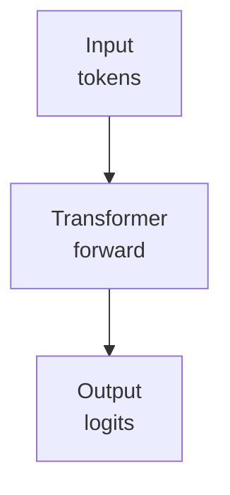

# Mermaid Diagram Rules

Use this when user asks for diagrams, architecture maps, training flows, code/dataflow, or visual wiki pages.

## Decision

| Need | Use |
|---|---|
| Durable written explanation | Markdown note |
| Any diagram inside a note | Mermaid |
| Large system/dataflow/code path | Mermaid, split into focused diagrams if needed |
| Blog/public static rendering | Mermaid when renderer supports it |

Rule: Markdown writes understanding; Mermaid draws flow.

## When Mermaid Helps

Use Mermaid for:

- `prefill -> decode -> KV cache append`
- `prompt -> rollout -> reward -> advantage -> policy update`
- `request -> scheduler -> KV manager -> model runner -> sampler`
- `dataset -> tokenizer -> dataloader -> trainer -> eval`
- project architecture or multi-module code reading

Avoid diagrams for:

- static definitions
- daily notes
- broad topic maps with no process
- paragraphs disguised as boxes

## Mermaid Layout

Default:

Rules:

- Prefer `flowchart TB` over `LR` for Obsidian readability.
- Keep one diagram focused on one main flow.
- Split large or heavily branching systems into multiple diagrams.
- Use ` ` not ` `.
- Do not set `fontFamily` in Mermaid init.
- Avoid `span style=...`.
- Keep node text short; manually break lines.
- If text clips, first shorten/split node text before CSS changes.

## Quality Check

Before finishing:

- diagram renders in Obsidian Live Preview or Reading view
- main path reads without zooming heavily
- no node contains a long paragraph
- arrows and branches match described mechanism
- diagram stays focused; split if branching becomes hard to follow
- note contains fenced `mermaid` block, not generated Canvas or SVG artifacts
